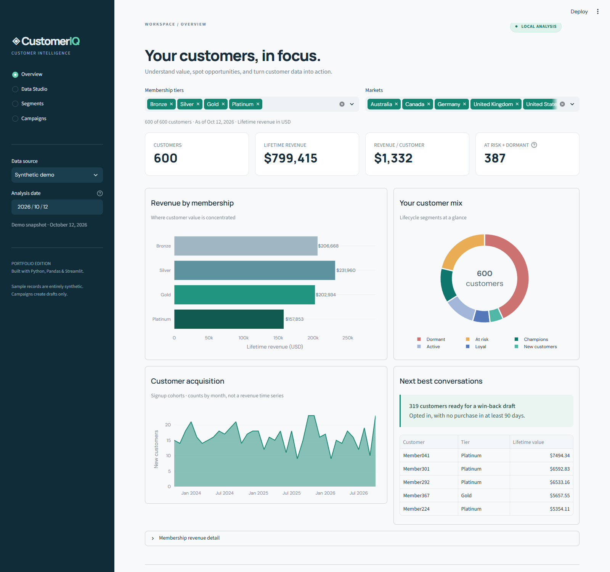
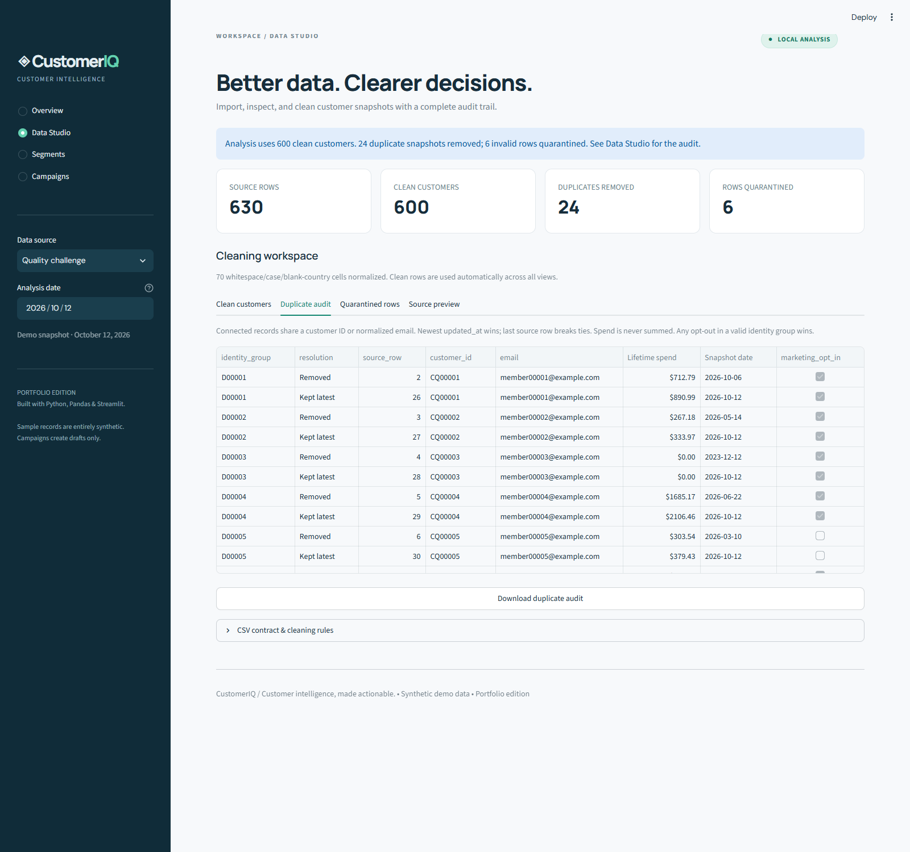
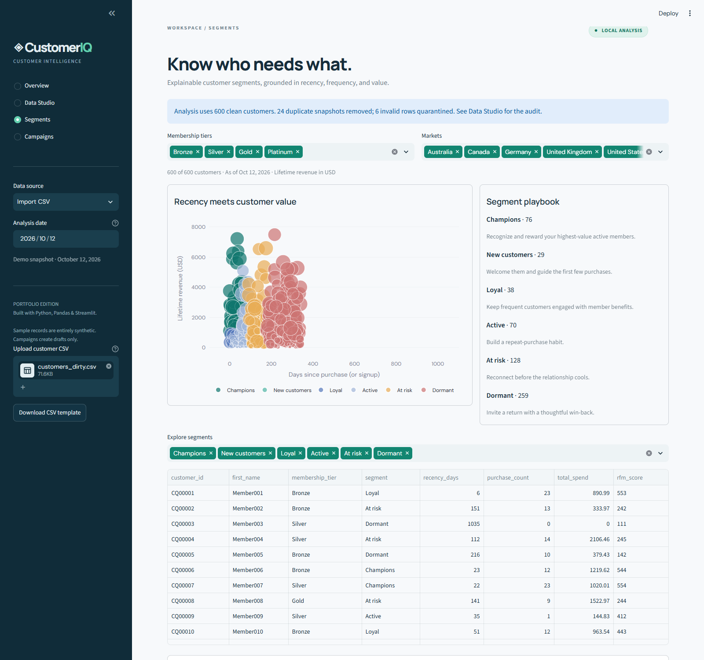
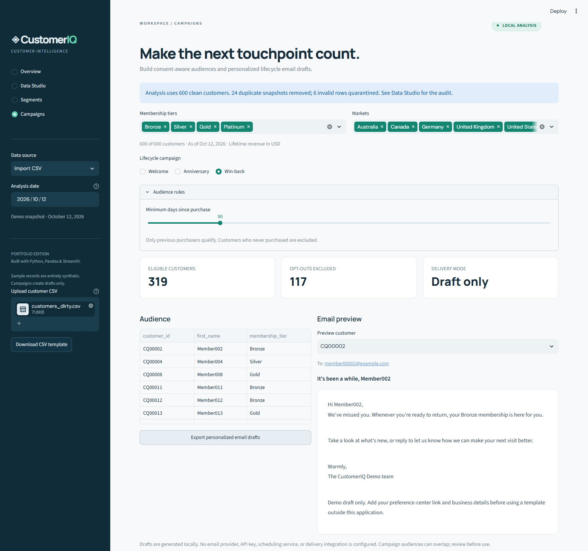

<div align="center">

# ◈ CustomerIQ

**Customer intelligence, made actionable.**

A Python, Pandas, and Streamlit application that turns customer snapshots into clean data, explainable segments, revenue insights, and lifecycle email drafts.

[](https://github.com/Vrishank-Vadi/CustomerIQ/actions/workflows/tests.yml)


[](LICENSE)

</div>



## Why CustomerIQ?

Customer exports often contain stale snapshots, inconsistent formatting, duplicate identities, and missing fields. CustomerIQ makes the path from a messy CSV to a usable customer audience visible and reproducible. Its business rules are explicit, the original file stays untouched, and every duplicate or rejected row can be inspected.

This is a working portfolio project with **600 entirely synthetic customers** and a **630-row data-quality challenge**. All sample addresses use `example.com`; no real customer information is included. Email automation generates drafts and audience exports only—there is no email delivery integration.

## Features

| Workspace | What you can do |
| --- | --- |
| **Overview** | Filter by tier and market; explore lifetime revenue, revenue per customer, membership performance, signup cohorts, and segment mix through interactive Plotly charts. |
| **Data Studio** | Import UTF-8 CSVs, normalize formatting, detect connected duplicate identities, quarantine invalid records, and export clean data plus audit reports. |
| **Segments** | Explore six explainable lifecycle groups, inspect RFM scores, compare recency with customer value, and export selected audiences. |
| **Campaigns** | Configure welcome, anniversary, and win-back windows; preview personalized emails; export opted-in customer drafts. |
| **Batch automation** | Run the same cleaning, analytics, segmentation, and email-drafting pipeline from the command line. |

## Quick start

Requires **Python 3.12 or 3.13** and Git. No API keys, database, or paid services are needed.

```bash
git clone https://github.com/Vrishank-Vadi/CustomerIQ.git
cd CustomerIQ
python -m venv .venv
```

Activate the virtual environment:

```powershell
# Windows PowerShell
.venv\Scripts\Activate.ps1
```

```bash
# macOS / Linux
source .venv/bin/activate
```

Install and launch:

```bash
python -m pip install -r requirements.txt
python -m streamlit run app.py
```

Open [localhost:8501](http://localhost:8501). The app starts with the synthetic demo and a fixed analysis date of **October 12, 2026**, making the examples reproducible. The analysis date is editable in the sidebar. On Windows, if activation is restricted, use `.venv\Scripts\python.exe` directly for the commands above.

## Try the complete workflow

1. Open **Overview** and compare revenue across membership tiers. Filter a tier or market to see the charts update.
2. Choose **Quality challenge** in the sidebar, then open **Data Studio**. The 630 source rows become **600 clean customers**, with **24 duplicate snapshots removed** and **6 invalid rows quarantined**.
3. Inspect the **Duplicate audit** and **Quarantined rows** tabs. Download the clean CSV; lifetime revenue remains **$799,415.00**, equal to the clean sample.
4. Switch to **Import CSV** and upload `data/customers_dirty.csv` to repeat the same process through the real uploader.
5. Explore **Segments**, then select **Campaigns** to preview and export personalized welcome, anniversary, and win-back drafts.

### Headless automation

```bash
python -m customeriq --input data/customers_dirty.csv --as-of 2026-10-12 --output exports/demo
```

This writes clean customers, duplicate and quarantine reports, segment and tier summaries, three campaign draft CSVs, and `report.json`. Re-running with the same inputs produces the same content and replaces files with the same names. Use a new output directory per run if you want history. The command is suitable for an external scheduler, but this repository does not install scheduled jobs or send messages.

## CSV contract

Start with [`data/import_template.csv`](data/import_template.csv). Each row is **one lifetime customer snapshot**, not one order. CSV limits are 10 MB and 50,000 rows. Use UTF-8 and comma delimiters. Column names are trimmed, lowercased, and spaces become underscores. Duplicate normalized column names are rejected; extra columns are ignored.

| Column | Required | Rules |
| --- | --- | --- |
| `customer_id` | Yes | Nonblank string; leading zeros are preserved. Exact, case-sensitive identity key after trimming. |
| `first_name`, `last_name` | Yes | Nonblank strings. |
| `email` | Yes | Basic address syntax validation; trimmed and lowercased for identity matching. |
| `membership_tier` | Yes | Bronze, Silver, Gold, or Platinum; capitalization is normalized. |
| `join_date` | Yes | `YYYY-MM-DD`; no later than the analysis date. |
| `last_purchase_date` | Column required | `YYYY-MM-DD`; blank only if purchase count and spend are both zero. |
| `total_spend` | Yes | Finite lifetime USD amount from 0 to 1 trillion, without currency symbols or thousands separators. |
| `purchase_count` | Yes | Whole number from 0 to 1 billion. |
| `marketing_opt_in` | Yes | `true/false`, `yes/no`, or `1/0`, case-insensitive. Unknown values are quarantined. |
| `updated_at` | Yes | Snapshot date, `YYYY-MM-DD`; on or after signup and last purchase, and no later than the analysis date. |
| `country` | No | Market label; omitted or blank values become `Unknown`. |

Purchases before signup and contradictory zero-purchase records are quarantined. Currency conversion, negative refund balances, transaction aggregation, and fuzzy name matching are outside this snapshot model.

### Duplicate resolution

1. Normalize and validate each row. Invalid rows go to quarantine and do not participate in identity resolution.
2. Connect valid records sharing **either customer ID or normalized email**, including transitive matches.
3. Keep the newest `updated_at` snapshot. If dates tie, keep the last source row. **Never sum snapshot revenue.**
4. Apply an opt-out if **any valid row** in that identity group is opted out.
5. Preserve all conflicting records in the duplicate audit with their `source_row`, group ID, and resolution.

This policy treats a shared ID/email as one identity; shared inboxes or reused IDs require manual source correction. Review the audit before using a cleaned audience. Invalid rows are excluded entirely, including their consent values. The quarantine report contains normalized values and issue descriptions; the source preview preserves the original imported values. `source_row` is the CSV record ordinal plus the header (not a physical line number for multiline fields).

## Analytics methodology

Revenue means the sum of retained customers' **lifetime spend**, not revenue earned during a selected period. Average order value is total spend divided by order count; revenue per customer is total spend divided by customer count. Zero denominators return zero. The acquisition chart counts customer signups by month—it does not imply transaction-level revenue history.

Segments use the first matching rule below. Recency is days since last purchase, or days since signup for customers who have never purchased.

| Priority | Segment | Rule |
| --- | --- | --- |
| 1 | Champions | Recency ≤ 60 days and lifetime spend ≥ $1,000 |
| 2 | New customers | Signup within the last 30 days |
| 3 | Loyal | Recency ≤ 60 days and at least 5 purchases |
| 4 | Active | Recency ≤ 90 days |
| 5 | At risk | Recency ≤ 180 days |
| 6 | Dormant | All remaining customers |

RFM is a three-digit descriptive score, with each dimension from 1 to 5:

| Score | Recency (R) | Frequency (F) | Monetary (M) |
| --- | --- | --- | --- |
| 5 | ≤ 30 days | ≥ 15 purchases | ≥ $2,000 |
| 4 | 31–60 days | 8–14 purchases | $1,000–$1,999.99 |
| 3 | 61–90 days | 4–7 purchases | $500–$999.99 |
| 2 | 91–180 days | 2–3 purchases | $100–$499.99 |
| 1 | > 180 days | 0–1 purchases | < $100 |

Thresholds are transparent demonstration rules, not a trained churn or revenue prediction model.

## Email automation rules

All campaigns require `marketing_opt_in = true` and honor the current tier and market filters.

| Campaign | Default audience |
| --- | --- |
| Welcome | Signed up today or in the previous 7 days. |
| Anniversary | First or later membership anniversary today or in the next 30 days. February 29 maps to February 28 in non-leap years. Year-end windows work across calendar years. |
| Win-back | At least one prior purchase and no purchase in at least 90 days. Non-buyers are excluded. |

Windows are adjustable in the app. Audiences may overlap. Templates live in [`templates/`](templates/), use plain text, and include no unapproved discount or incentive. Draft CSVs contain a customer ID, recipient, campaign, subject, and body. HTML preview values are escaped, and formula-leading strings are prefixed with an apostrophe in CSV exports for spreadsheet safety.

## Screenshots

Captured from the running application using [`scripts/browser_smoke.py`](scripts/browser_smoke.py).

<details>
<summary>Data Studio: inspect and resolve duplicates</summary>



</details>

<details>
<summary>Segments: recency, value, and customer playbooks</summary>



</details>

<details>
<summary>Campaigns: consent-aware email drafts</summary>



</details>

## Tests and verification

```bash
python -m pip install -r requirements-dev.txt
python -m pytest -q
```

The suite covers CSV parsing and validation, identity collisions and tie-breaking, revenue conservation, opt-out precedence, segment boundaries, RFM scores, empty data, anniversary calendar behavior, campaign exports, the batch command, and Streamlit navigation and filters. GitHub Actions runs it on Python 3.12 and 3.13.

For end-to-end browser checks, leave the Streamlit server running in a separate terminal:

```bash
python -m playwright install chromium
python scripts/browser_smoke.py
# Or use an existing Microsoft Edge installation:
python scripts/browser_smoke.py --channel msedge
```

The browser script uploads the dirty sample through the actual file input, verifies cleaning totals, downloads and parses CSVs, checks all three campaign types, exercises malformed and empty imports, and captures desktop and mobile screenshots. See [`docs/verification.md`](docs/verification.md) for the recorded verification results.

## Project structure

```text
CustomerIQ/
├── app.py                    # Streamlit UI and interactive charts
├── customeriq/
│   ├── data.py               # Parsing, validation, identity resolution, CSV export
│   ├── analytics.py          # Tier metrics, segments, and RFM scores
│   ├── campaigns.py          # Eligibility and template rendering
│   └── __main__.py           # Headless batch pipeline
├── data/                     # Clean, dirty, and empty-template synthetic CSVs
├── templates/                # Welcome, anniversary, and win-back email templates
├── scripts/                  # Data generator and browser smoke checks
├── tests/                    # Unit, integration, and Streamlit AppTest checks
├── docs/                     # Verification notes and screenshots
└── .github/workflows/        # CI tests
```

Data flows through `CSV → normalize → validate → resolve identities → analyze → segment → draft`. Domain logic is independent of Streamlit and reused by the UI, CLI, and tests. There is no persistent database; uploads are handled in the active app session and are not written to the source tree. Batch exports are explicitly written to the requested directory.

Regenerate the sample datasets deterministically:

```bash
python scripts/generate_data.py --count 600 --seed 42 --as-of 2026-10-12
```

Use `--output some/directory` to preserve the bundled examples. Changing the sample count, seed, or date changes the demo's expected totals and requires updating fixture assertions.

## Scope and deployment

This repository publishes the complete runnable application and documentation on GitHub. GitHub Pages does not run a Python/Streamlit server. Run the app locally with the instructions above, or deploy `app.py` on a Python host that supports Streamlit using `requirements.txt`. Bind to the host-provided port as required by your hosting provider.

The demo has no authentication, durable job queue, email sending, delivery tracking, or production consent registry. Keep demonstration uploads synthetic. The app processes data on the machine hosting Streamlit; a remotely hosted instance therefore processes uploads on that remote host. The optional Google Fonts stylesheet may make a browser request to Google; system-font fallbacks work offline.

## License

Released under the [MIT License](LICENSE).
